# Architecture — Application MOBILE (COLLECTEUR)

> Diagrammes de l'app collecteur **QcApp** (`test-app-qc/QcApp`) — Expo SDK 54,
> React Native 0.81, React 19. Établi le 12/11/2026 par lecture du dépôt.
> Document frère : **[ARCHITECTURE_WEB.md](./ARCHITECTURE_WEB.md)**.
>
> ⚠️ **Dépôt git SÉPARÉ**, exclu du dépôt web par `.gitignore`. Lancer toutes
> les commandes depuis `test-app-qc/QcApp`.

## Ordres de grandeur (mesurés)

| Fichier | Lignes | Rôle |
|---|---|---|
| `ReceptionScreen.js` | 3 572 | contrôle de réception — le plus gros écran |
| `PreparationScreen.js` | 1 233 | préparation de commande, dock puis magasin |
| `api.js` | 1 170 | **toute** la couche réseau |
| `DemandeReapproScreen.js` | 1 038 | listes de réappro poussées du web |
| `InventaireScreen.js` | 988 | collecte d'inventaire par zone |
| `ReapproRayonScreen.js` | 906 | réappro rayon, sans état |
| `ui.js` | 720 | composants partagés |
| `InventaireOfflineScreen.js` | 721 | inventaire hors ligne |
| `ControleScreen.js` | 643 | contrôle de commande |
| `App.js` | 577 | **le shell** — auth, société, menus |
| **Total** | **~16 800** | 13 écrans de scan, 0 test |

### Sommaire

1. [Vue d'ensemble](#1-vue-densemble--ou-vit-lapp)
2. [Le shell App.js](#2-le-shell--appjs)
3. [Carte des menus et des outils](#3-carte-des-menus-et-des-outils)
4. [Modules partagés](#4-modules-partagés--ne-pas-dupliquer-leurs-préoccupations)
5. [La chaîne de scan douchette](#5-la-chaîne-de-scan-douchette--13-écrans-une-seule-règle)
6. [Inventaire en ligne](#6-inventaire-par-zone--en-ligne)
7. [Inventaire hors ligne](#7-inventaire-hors-ligne)
8. [Réappro — quatre outils](#8-réappro--quatre-outils-distincts)
9. [Préparation de commande](#9-préparation-de-commande--dock-puis-magasin)
10. [Réception](#10-réception--le-plus-gros-écran)
11. [Chat et notifications](#11-chat-notifications-et-présence)
12. [Mapping endpoints ↔ backend](#12-mapping-endpoints-mobiles--routeurs-backend)
13. [Build et distribution](#13-build-et-distribution)
14. [Pièges connus](#14-pièges-connus)

---

## 1. Vue d'ensemble — où vit l'app

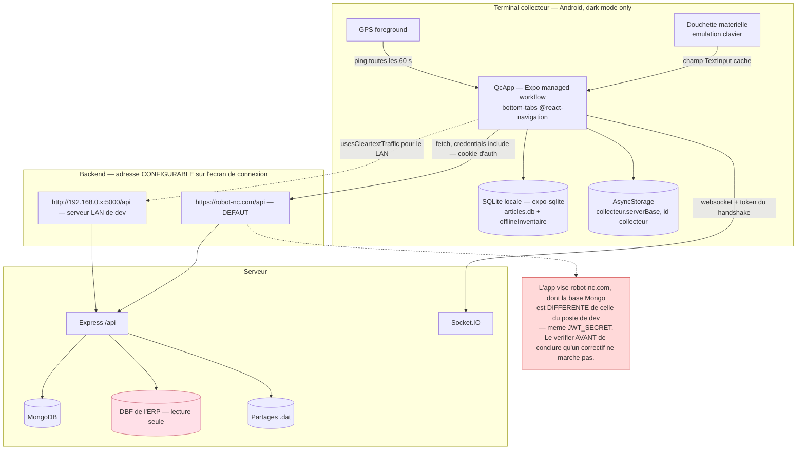

> **L'app de scan réception est un client RN sur un AUTRE backend** ; le Mongo est
> un Atlas cloud partagé. À vérifier avant de conclure qu'un correctif est inopérant.

---

## 2. Le shell — `App.js`

`App.js` fait **trois** choses, et c'est le **seul** endroit à étendre pour ajouter
une fonctionnalité.

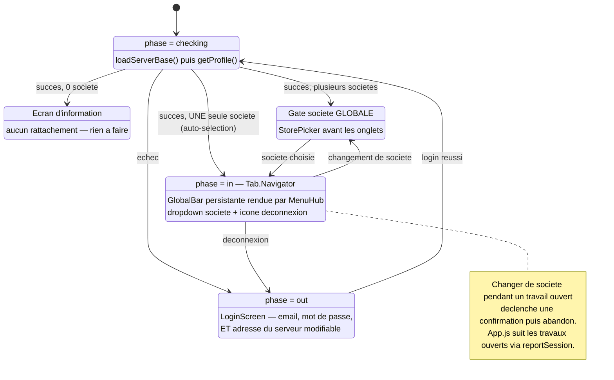

### Navigation PILOTÉE PAR CONFIG

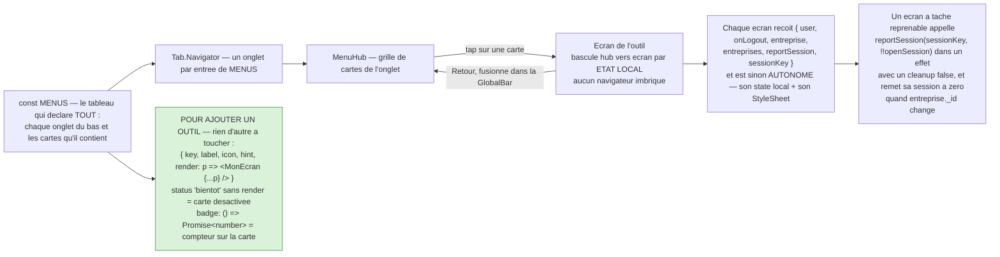

> La société choisie vit dans `App.js`, **pas par écran**. Utiliser l'objet
> `entreprise` reçu (`_id`, `trigramme`, `nomComplet`, `nomDossierDBF`) plutôt que
> de le redériver de `user.permissions.entreprises`. Les écrans ne rendent plus
> leur propre sélecteur de magasin ni leur lien de déconnexion.

---

## 3. Carte des menus et des outils

```mermaid
flowchart TB
    ROOT(["Bottom tabs"])

    ROOT --> M1["SCAN — barcode-outline"]
    M1 --> M1A["Scan article — ScanScreen<br/>consulter un article<br/>lit les articles par l'API, PAS la base locale"]
    M1 --> M1B["Recherche web — RechercheWebScreen<br/>infos produit en ligne"]

    ROOT --> M2["REAPPRO — cube-outline"]
    M2 --> M2A["Reappro — ReapproScreen<br/>creer un reappro libre"]
    M2 --> M2B["Listes de reappro — DemandeReapproScreen<br/>preparer une liste au dock<br/>BADGE = nombre de listes a faire"]
    M2 --> M2C["Reappro rayon — ReapproRayonScreen<br/>biper le QR d'un rayon<br/>SANS ETAT"]
    M2 --> M2D["Ou ranger ? — RangementScreen<br/>scanner un article vers son rayon<br/>CONSULTATION PURE"]

    ROOT --> M3["BIPAGE — scan-outline"]
    M3 --> M3A["Bipage — BipageScreen<br/>bipage terminal libre"]
    M3 --> M3B["Demandes bipage — DemandeBipageScreen<br/>articles a biper, proforma ou gisement<br/>BADGE"]

    ROOT --> M4["INVENTAIRE — clipboard-outline"]
    M4 --> M4A["Inventaire — InventaireScreen<br/>collecte de zone EN LIGNE"]
    M4 --> M4B["Inventaire hors ligne — InventaireOfflineScreen<br/>biper sans reseau, deposer plus tard"]
    M4 --> M4C["Bientot — carte desactivee"]

```

### Menus Commande, Réception et Compte

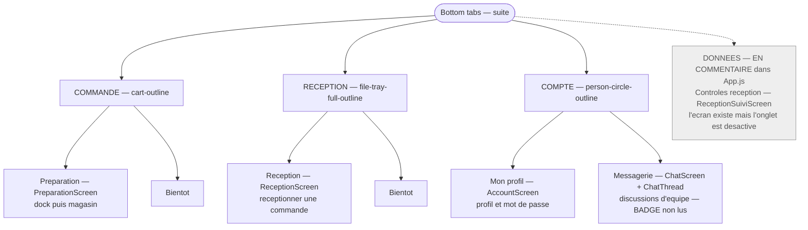

---

## 4. Modules partagés — ne pas dupliquer leurs préoccupations

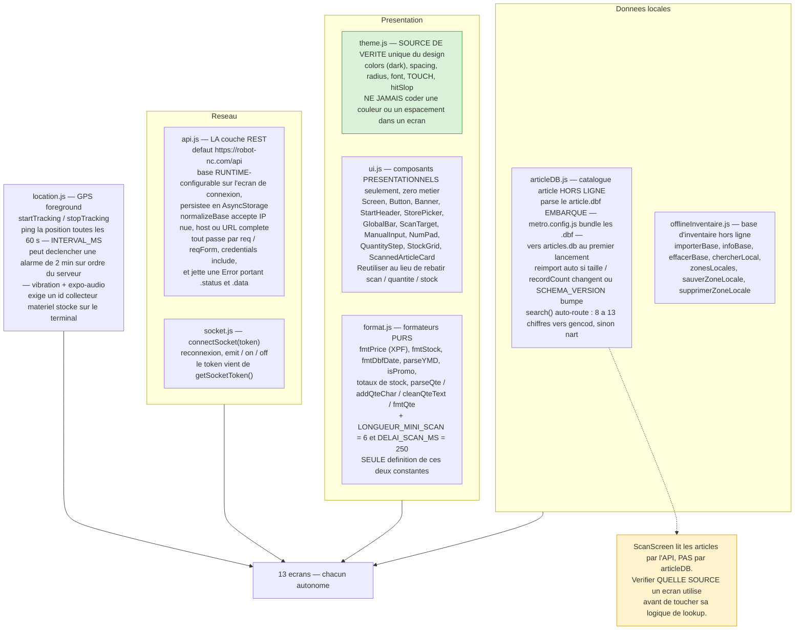

---

## 5. La chaîne de scan douchette — 13 écrans, une seule règle

Le point le plus piégeux de l'app. Règles figées le 10/09/2026, corrigées le
09/11/2026.

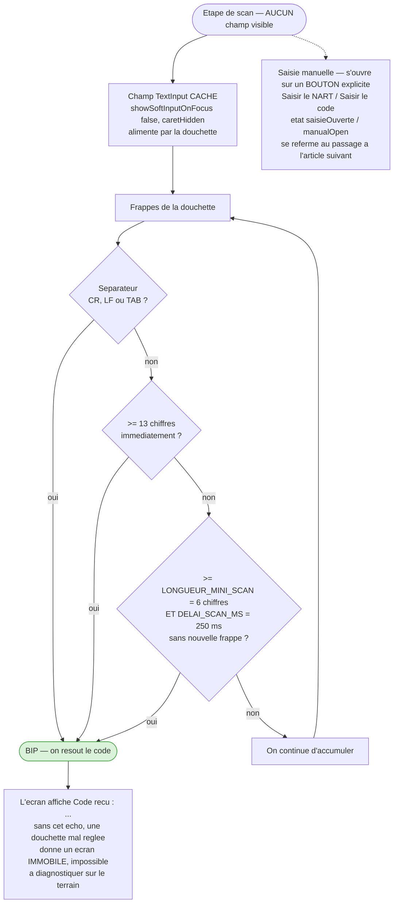

### Les cinq règles du champ caché

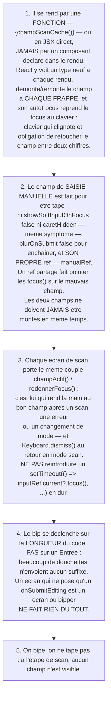

### Pourquoi un PLANCHER et non une liste blanche

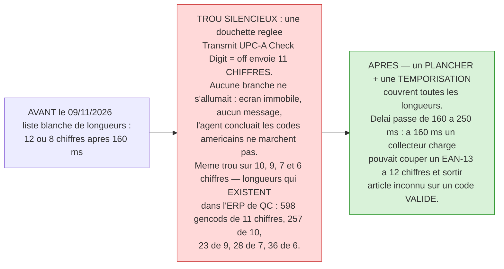

**Les 13 écrans concernés** : scan, bipage, contrôle, inventaire, inventaire hors
ligne, préparation, réception, réappro, réappro rayon, rangement, recherche web,
demandes de réappro, demandes de bipage.

---

## 6. Inventaire par zone — EN LIGNE

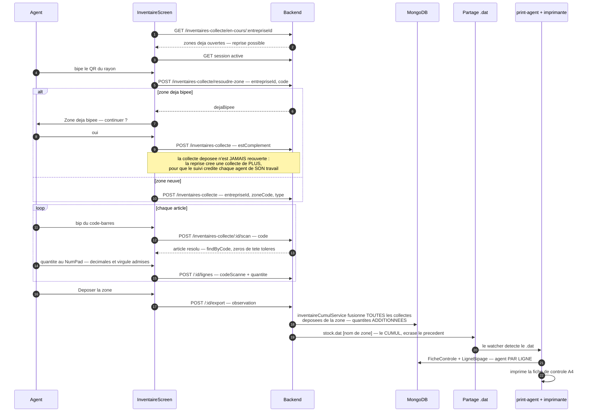

---

## 7. Inventaire hors ligne

Ajouté le 29/10/2026. Même chaîne d'arrivée que le dépôt en ligne — cœur partagé
`effectuerDepot`.

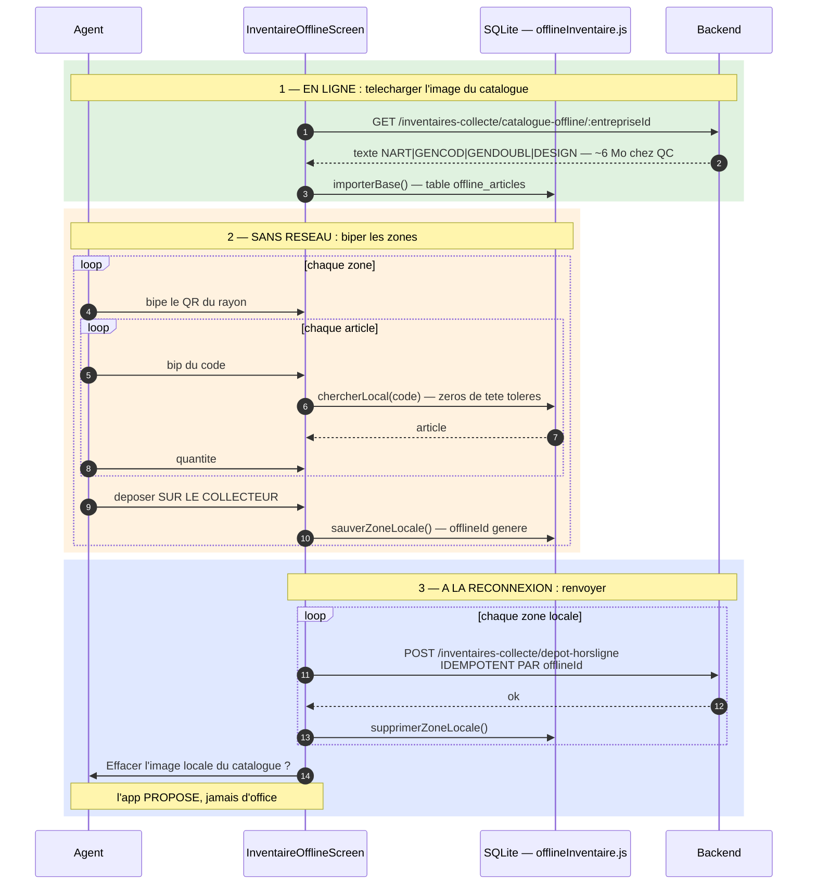

---

## 8. Réappro — quatre outils distincts

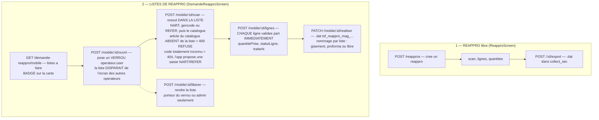

### Réappro — les deux outils SANS ÉTAT

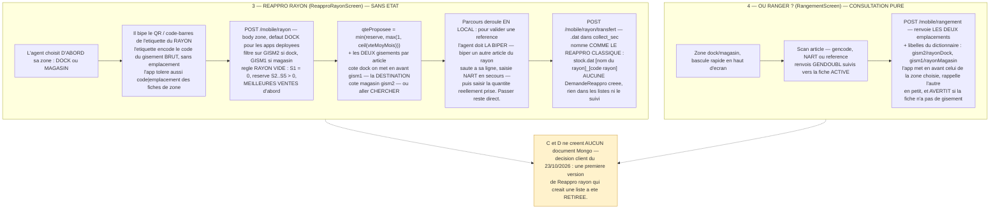

### Quantités décimales — règle transverse

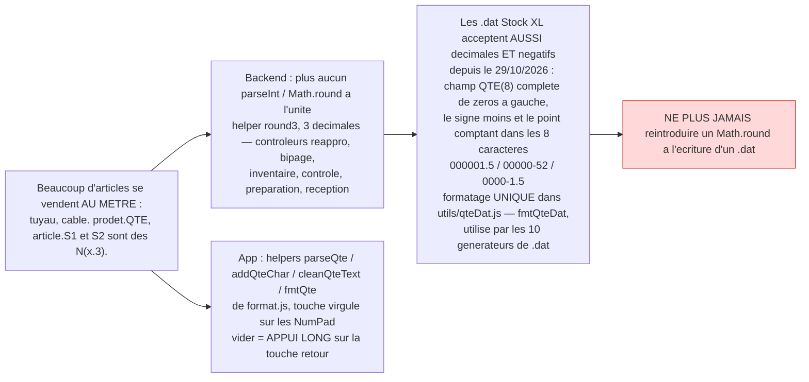

---

## 9. Préparation de commande — dock puis magasin

Parcours en **trois temps** par article (décision client du 09/09/2026).

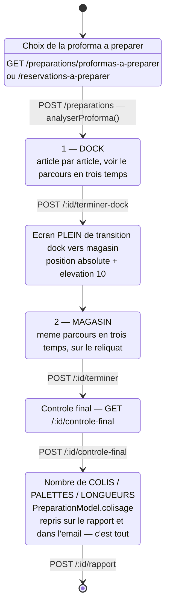

### Le parcours en trois temps, pour chaque article

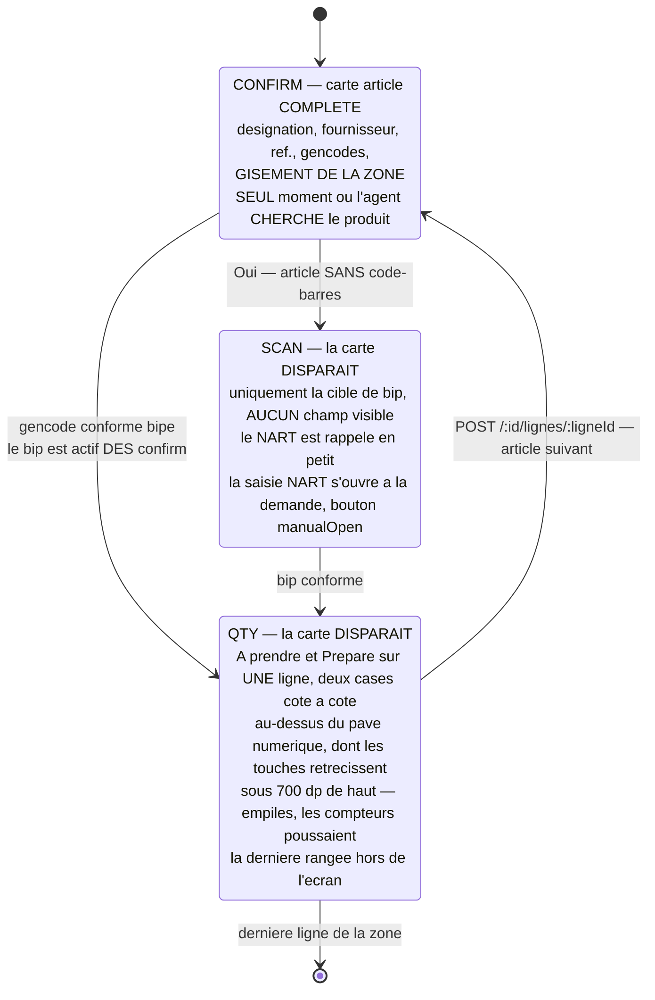

### Répartition dock / magasin — qui décide

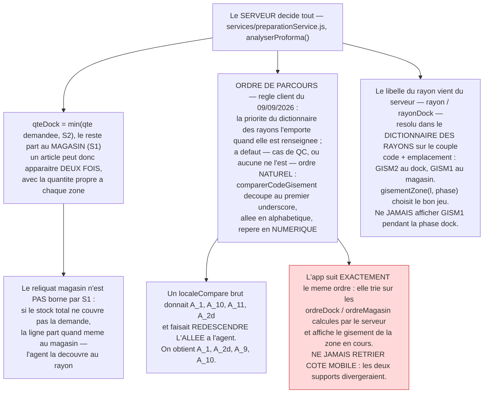

> **Colisage** : les **feuilles de colisage** (une A4 par unité) et la
> **répartition article par article** ont été **retirées le 09/09/2026** à la
> demande du client. Seuls les compteurs subsistent. Le code correspondant
> (`ecrirePDFColisage`, `listerUnitesColisage`, `construireLignesColisage`) a été
> **supprimé**, pas mis en commentaire — ne pas le réintroduire sans décision.

> **Abandonner une préparation demande une confirmation** (`Alert.alert`) : le lien
> est à portée de pouce pendant toute la préparation. Il est masqué sur les écrans
> de transition, où une seule action doit être possible.

---

## 10. Réception — le plus gros écran

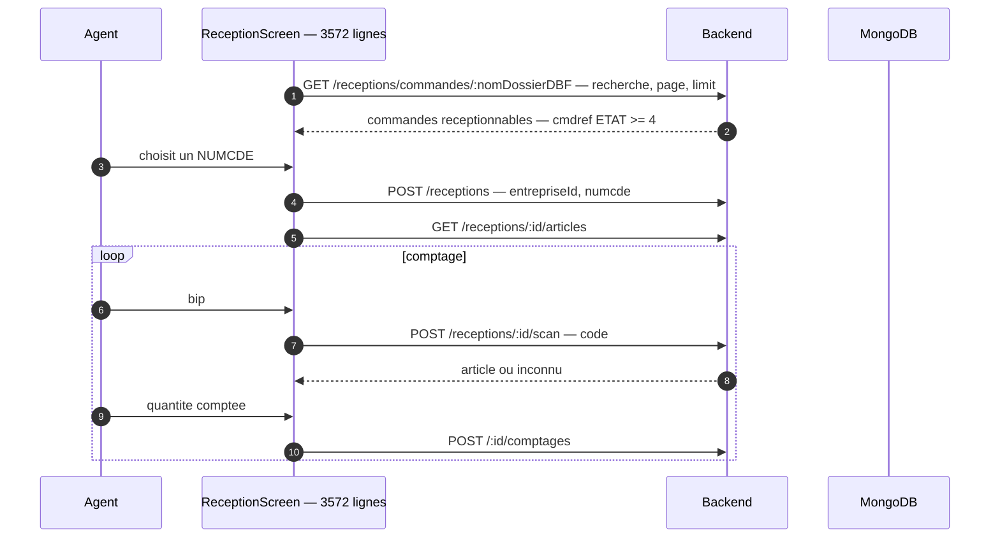

### Réception — conflits, anomalies et clôture

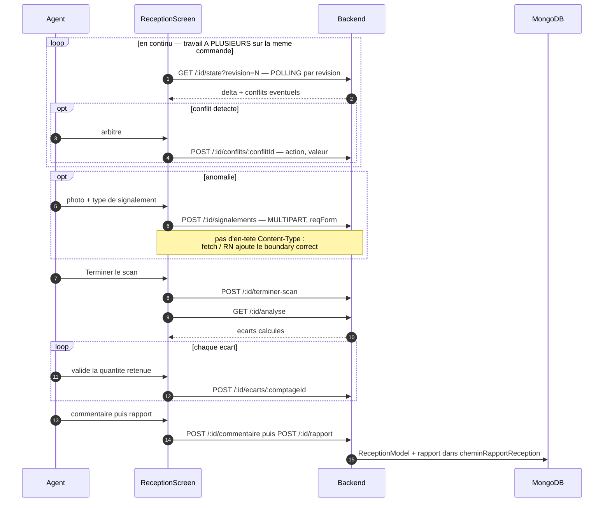

Le module web jumeau **`reception_manuelle`** produit au contraire une fiche
papier **sans quantités imprimées** — comptage à l'aveugle. Voir
[ARCHITECTURE_WEB.md §14](./ARCHITECTURE_WEB.md#deux-modules-jumeaux-deux-règles-métier-opposées).

---

## 11. Chat, notifications et présence

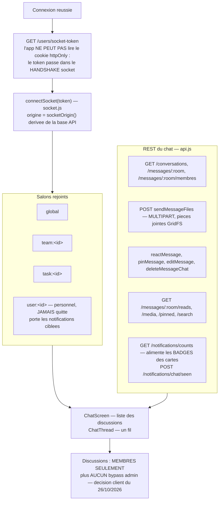

---

## 12. Mapping endpoints mobiles ↔ routeurs backend

```mermaid
flowchart LR
    subgraph app["api.js — groupes de fonctions"]
        F1["Auth<br/>login, getProfile, logout, changePassword"]
        F2["Chat<br/>getSocketToken, conversations, messages, notifications"]
        F3["Reappro libre<br/>createReappro, scanArticle, addLigne, exportReappro"]
        F4["Bipage libre<br/>createBipage, scanArticleBipage, exportBipage"]
        F5["Inventaire collecte<br/>resoudreZoneInventaire, createCollecte, scanArticleCollecte,<br/>exportCollecte, getCatalogueOffline, depotHorsLigne"]
        F6["Articles<br/>getArticleByGencodApi, getArticleByNartApi, photoUrl"]
    end

    subgraph back1["Routeurs backend"]
        R1["/api/users"]
        R2["/api/messages /api/conversations /api/notifications"]
        R3["/api/reappros"]
        R4["/api/bipage-collecte"]
        R5["/api/inventaires-collecte"]
        R6["/api/articles /api/photos"]
    end

    F1 --> R1
    F2 --> R2
    F3 --> R3
    F4 --> R4
    F5 --> R5
    F6 --> R6
```

### Endpoints — métier et terrain

```mermaid
flowchart LR
    subgraph app2["api.js — suite"]
        F7["Reception<br/>getCommandesReception, createReception, scanReception,<br/>comptages, signalements, analyse, ecarts, rapport"]
        F8["Preparation<br/>getProformasAPreparer, createPreparation, scanControle,<br/>preparerLigne, terminerDock, controleFinal, colisage, rapport"]
        F9["Demandes reappro<br/>getDemandesReappro, ouvrir, liberer, scan, lignes, realiser"]
        F10["Reappro rayon / rangement<br/>getArticlesReapproRayon, transfertReapproRayon, getRangementArticle"]
        F11["Demandes bipage<br/>getDemandesBipage, realiserDemandeBipage"]
        F12["Collecteur<br/>getCollecteurId, pingCollecteur"]
        F13["Suivi reception<br/>getReceptionsEnCoursSuivi, getReceptionProgressSuivi"]
    end

    subgraph back["Routeurs backend"]
        R7["/api/receptions"]
        R8["/api/preparations"]
        R9["/api/demande-reappro/mobile/*"]
        R11["/api/demande-bipage/mobile/*"]
        R12["/api/collecteurs"]
        R13["/api/reception-suivi/mobile/*"]
        R14["/api/app-release — GET /current est PUBLIC :<br/>page d'installation"]
    end

    F7 --> R7
    F8 --> R8
    F9 --> R9
    F10 --> R9
    F11 --> R11
    F12 --> R12
    F13 --> R13

    style R14 fill:#e6e6ff,stroke:#6666cc
```

---

## 13. Build et distribution

```mermaid
flowchart LR
    DEV["npm start — expo start, Metro<br/>npm run android / ios / web"]

    subgraph eas["EAS — eas.json"]
        E1["development — APK dev-client"]
        E2["preview — APK interne"]
        E3["production — Android app bundle"]
    end

    VER["Bumper android.versionCode dans app.json<br/>a CHAQUE build store"]
    STORE["Play Store PRIVE — piste Tests internes"]
    NATIF["Les dossiers ios/ et android/ sont git-ignores<br/>et GENERES par EAS"]
    MOD["Ajouter un module natif avec npx expo install [pkg]<br/>— PAS npm install — pour rester compatible SDK 54"]
    DOCS["Consulter les docs VERSIONNEES du SDK installe<br/>https://docs.expo.dev/versions/v54.0.0/"]
    NOTEST["AUCUN test, linter ni type-checker configure :<br/>ne pas supposer que npm test / npm run lint existent"]

    DEV --> eas --> VER --> STORE
    eas --> NATIF
    DEV --> MOD --> DOCS
    DEV --> NOTEST

    style NOTEST fill:#ffd9d9,stroke:#cc3333
    style VER fill:#fff2cc,stroke:#cc9933
```

---

## 14. Pièges connus

```mermaid
flowchart TB
    subgraph rn["React Native / Android"]
        P1["SUPERPOSITION : zIndex seul NE SUFFIT PAS —<br/>l'ordre de rendu prime tant qu'aucune elevation n'est posee.<br/>Les ecrans PLEINS en position absolute portent elevation 10,<br/>l'overlay de chargement elevation 20.<br/>Sans ca, le lien Annuler la preparation, rendu apres,<br/>retombait pile sur le bouton Passer au magasin."]
        P2["Dark mode ONLY — userInterfaceStyle dark dans app.json<br/>Android : softwareKeyboardLayoutMode resize<br/>+ usesCleartextTraffic, pour les serveurs LAN en http://"]
        P3["Objectif ERGONOMIE : chaque etape doit tenir SANS SCROLLER<br/>sur l'ecran bas du collecteur"]
    end

    subgraph scan["Scan"]
        S1["Les 5 regles du champ cache — section 5<br/>Ne jamais declarer le champ comme composant dans le rendu"]
        S2["LONGUEUR_MINI_SCAN et DELAI_SCAN_MS vivent dans format.js :<br/>SEULE definition, ne pas remettre de nombre en dur dans un ecran"]
    end

    subgraph data["Donnees"]
        D1["ScanScreen lit l'API, PAS articleDB :<br/>verifier la source avant de changer une logique de lookup"]
        D2["Le backend vise par l'app a une base Mongo DIFFERENTE<br/>de celle du poste de dev"]
        D3["Ne JAMAIS afficher GISM1 pendant la phase dock<br/>— chez QC les deux gisements differrent presque toujours"]
        D4["Ne JAMAIS retrier les lignes cote mobile :<br/>l'ordre vient du serveur, ordreDock / ordreMagasin"]
    end

    subgraph code["Code"]
        C1["Vocabulaire metier en FRANCAIS :<br/>reappro, bipage, collecte, reception, preparation,<br/>proforma / numcde, entreprise / trigramme,<br/>nart, gencod, S1..S5"]
        C2["theme.js et ui.js sont les sources uniques :<br/>aucune couleur ni espacement en dur dans un ecran"]
        C3["Le bloc de commentaires d'App.js previent contre toute<br/>modification de la logique des ecrans quand on touche<br/>la couche menu / hub : l'extension prevue est ADDITIVE —<br/>une nouvelle carte, rien de plus"]
    end

    style P1 fill:#fff2cc,stroke:#cc9933
    style D2 fill:#ffd9d9,stroke:#cc3333
    style D4 fill:#ffd9d9,stroke:#cc3333
```
