# Architecture — Application WEB

> Diagrammes de l'outil interne B2B multi-sociétés (groupe de quincailleries de
> Nouvelle-Calédonie). Établi le 12/11/2026 par lecture du dépôt.
> Document frère : **[ARCHITECTURE_MOBILE.md](./ARCHITECTURE_MOBILE.md)**.
>
> Les diagrammes sont en **Mermaid** : ils se rendent dans VS Code (extension
> *Markdown Preview Mermaid Support*), GitHub, Obsidian ou sur mermaid.live.

## Ordres de grandeur (mesurés sur le dépôt)

| Couche | Volume |
|---|---|
| Backend | ~106 600 lignes — **88 routeurs**, **90 contrôleurs**, **106 services**, **67 modèles** (+5 masterConfig) |
| Frontend | ~87 900 lignes — **120 écrans**, **81 slices** RTK Query / Redux, ~50 composants |
| App collecteur | ~16 800 lignes (dépôt git séparé, `test-app-qc/QcApp`) |
| Tests | **aucun** — ni back, ni front, ni mobile |

### Sommaire

1. [Vue d'ensemble de la plateforme](#1-vue-densemble-de-la-plateforme)
2. [Les deux sources de données](#2-les-deux-sources-de-données--le-cœur-de-larchitecture)
3. [Chaîne de traitement d'une requête API](#3-chaîne-de-traitement-dune-requête-api)
4. [Authentification, rôles et permissions](#4-authentification-rôles-et-permissions)
5. [Frontend — pile et gardiennage](#5-frontend--pile-et-gardiennage-des-routes)
6. [Carte des domaines fonctionnels](#6-carte-des-domaines-fonctionnels--88-routeurs)
7. [Modèle de données MongoDB](#7-modèle-de-données-mongodb)
8. [Tâches de fond et impression](#8-tâches-de-fond-et-chaîne-dimpression)
9. [Flux inventaire par zones](#9-flux-inventaire-par-zones--de-bout-en-bout)
10. [Espace commercial](#10-espace-commercial--découpage-imposé-par-la-perf)
11. [API partenaire](#11-api-partenaire--apipublicv1)
12. [Temps réel](#12-temps-réel--socketio)
13. [Dev / prod et variables d'environnement](#13-bascule-devprod-et-variables-denvironnement)
14. [Pièges connus et dette](#14-pièges-connus-et-dette-identifiée)

---

## 1. Vue d'ensemble de la plateforme

Qui parle à qui, et par quoi.

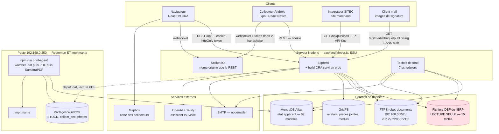

**À retenir**

- L'ERP est **strictement en lecture** : aucune écriture DBF n'existe dans le code,
  et il ne doit pas en être ajouté.
- Le backend de production est un **VPS Ubuntu qui ne peut pas imprimer** ;
  l'impression des fiches de contrôle est portée par l'agent local sur
  `192.168.0.250`, branché au **même** Mongo Atlas.
- `BASE_URL = ""` côté front : **même origine** — proxy CRA en dev, Express
  servant le build en prod.

---

## 2. Les deux sources de données — le cœur de l'architecture

Ce n'est **pas** une application CRUD Mongo. Deux backends cohabitent, et tout ce
qui vient du DBF est scopé par société via le paramètre de route `:nomDossierDBF`.

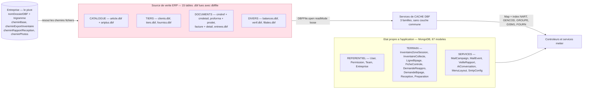

### Les trois familles de cache DBF

Relire le DBF à chaque requête est trop lent — 90 000+ articles, **1,7 M factures
et 6,2 M lignes** chez QC.

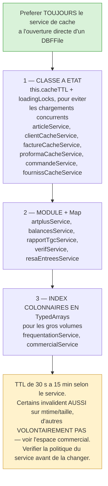

### Règles DBF non négociables

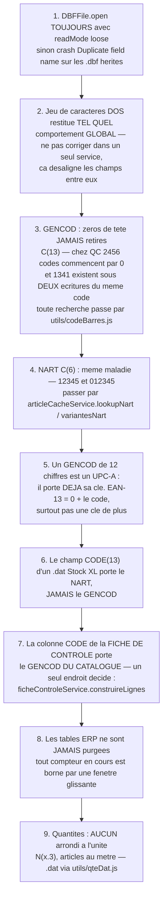

**Trois codes à ne pas confondre** sur la chaîne d'inventaire :

| Usage | Code employé | Décidé dans |
|---|---|---|
| Écriture du `.dat` Stock XL | **NART** | `genererContenuFichier` |
| Résolution de l'article | **code réellement bipé** | `InventaireCollecte.lignes[].codeScanne` |
| Affichage fiche de contrôle | **GENCOD du catalogue** | `ficheControleService.construireLignes` |

---

## 3. Chaîne de traitement d'une requête API

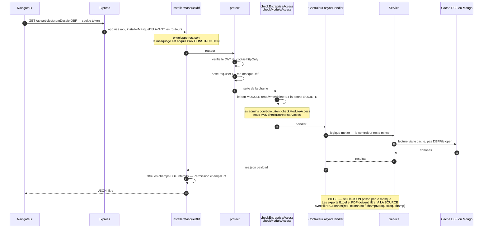

Les erreurs remontent à `notFound` puis `errorHandler`
(`backend/middleware/errorMiddleware.js`). Un nouveau routeur doit être
**importé ET monté** (`app.use()`) dans `backend/server.js`.

---

## 4. Authentification, rôles et permissions

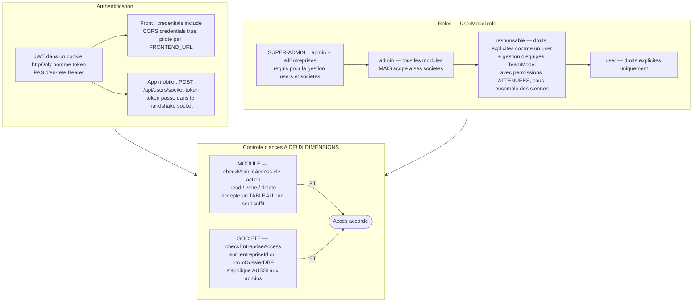

### Gardes complémentaires et droits fins

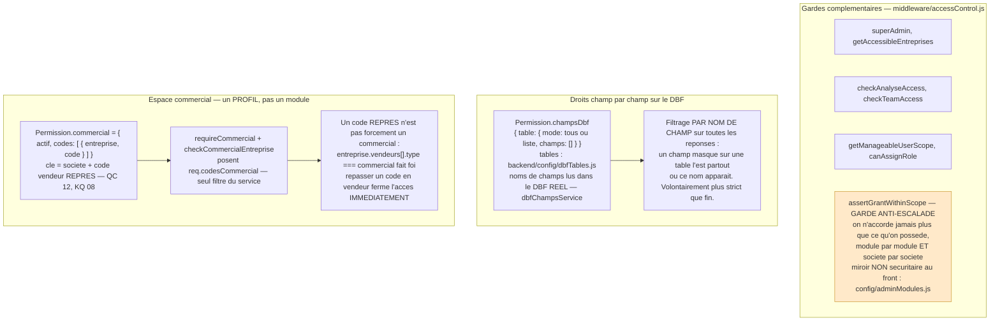

**Exception assumée au scoping société** : `GET /api/inventaires-zones/:entrepriseId/agents-possibles`
renvoie **tous** les comptes actifs — un inventaire est régulièrement renforcé par
du personnel d'une autre société du groupe, qui doit pouvoir être crédité de son
travail. La route reste `admin` + `checkEntrepriseAccess` et ne renvoie que
l'identité (nom, e-mail).

**Décision client** : un responsable gère **tous** les utilisateurs de ses
sociétés, pas seulement les membres de son équipe.

### Le registre des modules vit à TROIS endroits

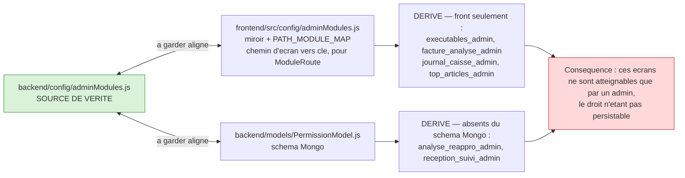

> **En ajoutant un module, mettre à jour les trois.** Vérifier ces trois fichiers
> avant de conclure qu'un droit « ne marche pas ».

---

## 5. Frontend — pile et gardiennage des routes

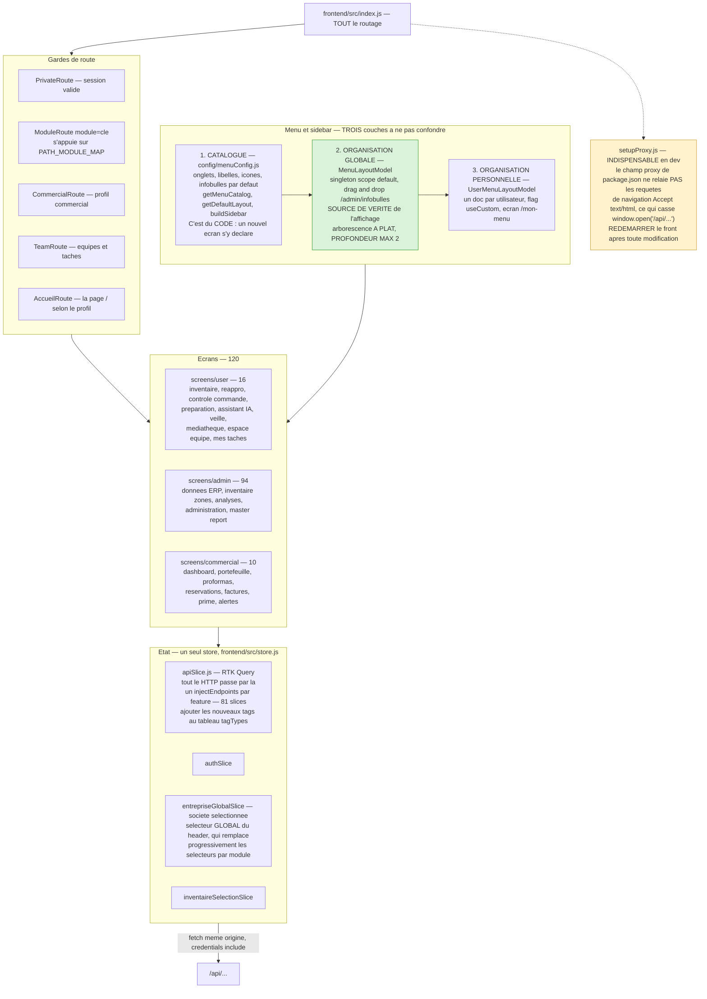

**Sidebar** : elle s'ouvre **entièrement repliée** (décision client — l'état des
dossiers n'est plus persisté en localStorage). Le champ de recherche sous le
switch Défaut/Perso est le chemin rapide : il aplatit tout le menu, filtre sans
accent ni casse, et affiche le chemin du dossier sous chaque résultat.

Si un lien de sidebar « manque » alors qu'il est bien dans le DOM : suspecter
`max-height` / `overflow` **avant** les permissions.

---

## 6. Carte des domaines fonctionnels — 88 routeurs

Repères pour situer un écran ou un routeur. Les préfixes API sont sous `/api/`.

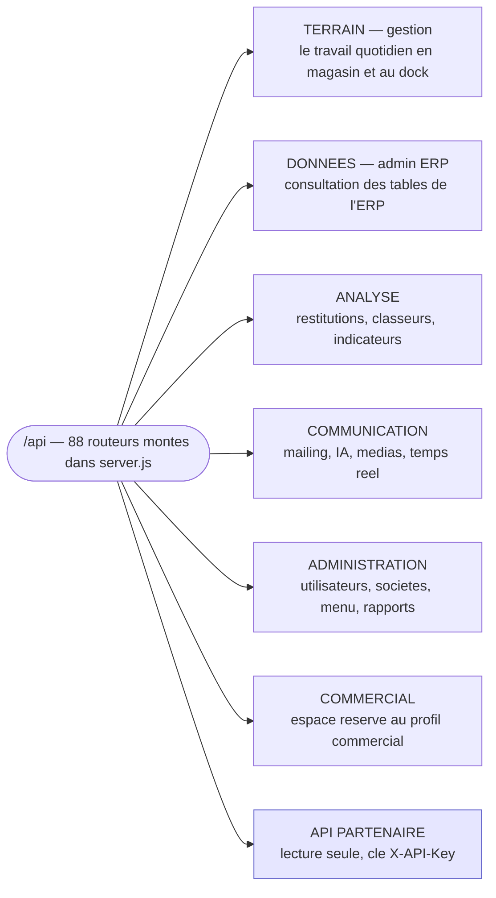

### Domaines — Terrain

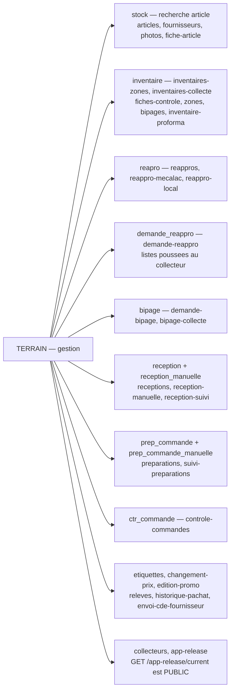

### Domaines — Données et Analyse

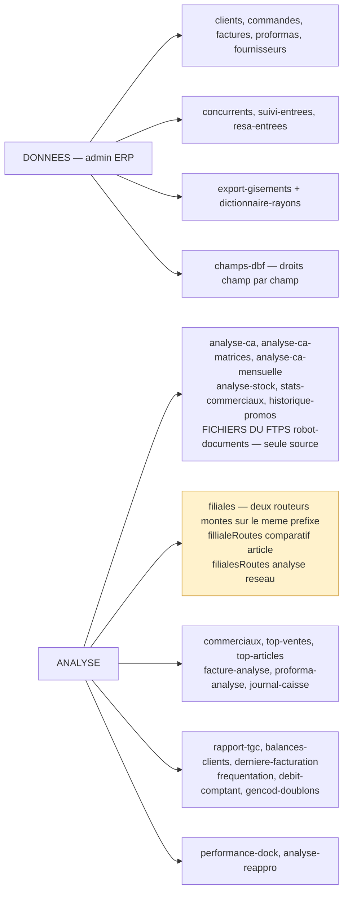

### Domaines — Communication, Administration, API partenaire

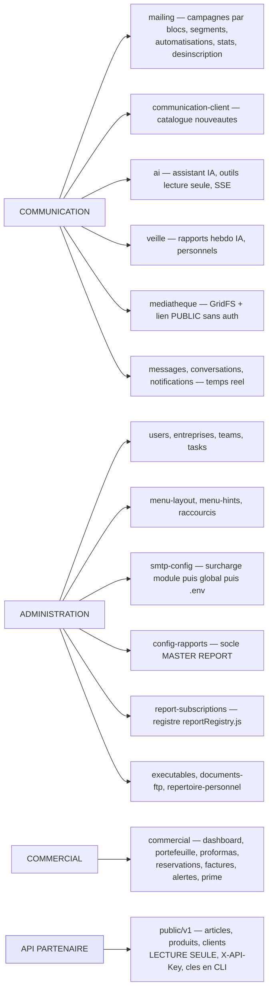

### Deux « suivis bipage » à ne pas confondre

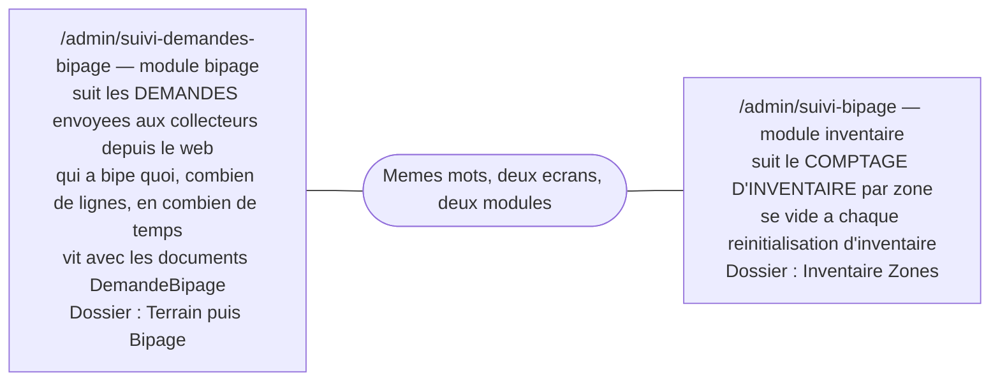

### Réappro et bipage ne posent PAS la même question

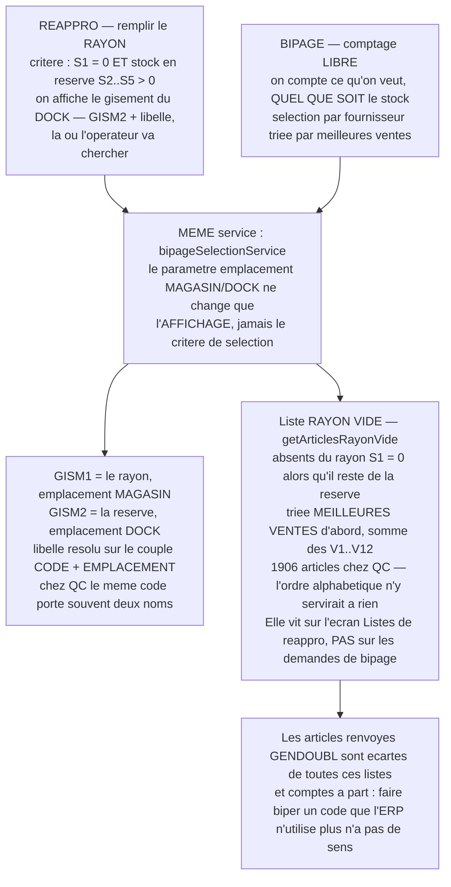

---

## 7. Modèle de données MongoDB

Les entités centrales et leurs liens (67 modèles — seuls les pivots figurent ici).

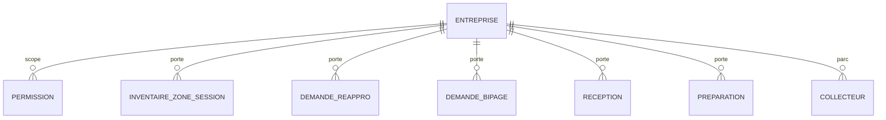

### Modèle de données — utilisateurs, équipes et échanges

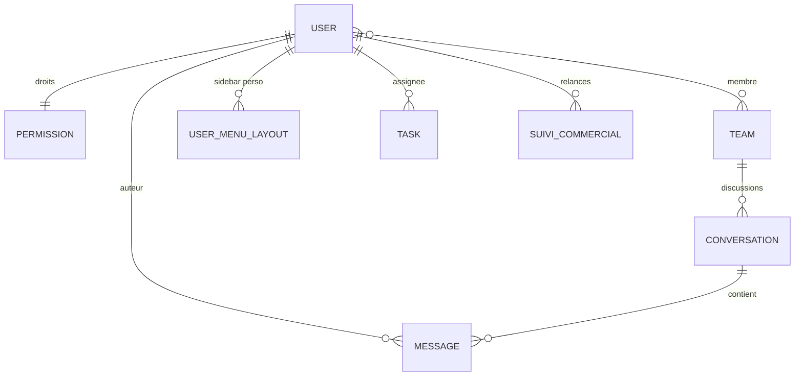

### Modèle de données — les flux du terrain

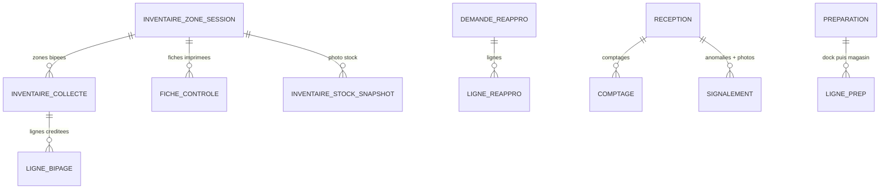

### Modèle de données — mailing et configuration

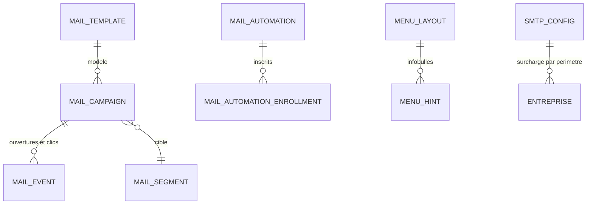

### Les champs qui portent les décisions

Le détail des pivots : ce sont ces champs-là qui décident du comportement.

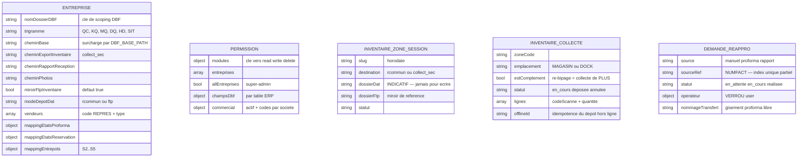

---

## 8. Tâches de fond et chaîne d'impression

```mermaid
flowchart TB
    subgraph srv["server.js — demarrage"]
        LOAD["backend/loadEnv.js<br/>DOIT RESTER LE PREMIER IMPORT :<br/>des services lisent process.env au chargement du module"]
    end

    subgraph sched["Taches de fond demarrees"]
        W["startInventaireWatcher<br/>surveille le partage .dat, genere le PDF de fiche<br/>et l'imprime via SumatraPDF / pdf-to-printer<br/>NE DEMARRE PAS si RCOMMON_STOCK_ROOT est defini<br/>surcharge par RUN_FICHE_WATCHER"]
        MS["startMailingScheduler — envoi par lots, 25/h"]
        AIS["startAiSnapshotScheduler — snapshots de ventes"]
        MET["startMeteoScheduler — contexte de l'ecran Frequentation"]
        CIW["startCommercialIndexWarmer — toutes les 8 min,<br/>societes a commercial actif seulement<br/>188 s mesurees en prod si un utilisateur paie le scan"]
        RPS["startReapproProformaScheduler — import horaire<br/>des proformas dont TEXTE commence par reappro"]
        VS["startVeilleScheduler — rapports hebdomadaires"]
        RSS["startReapproSnapshotScheduler — photo quotidienne du rayon vide"]
    end

    ORPH["startReportScheduler — services/reportScheduler.js<br/>EXISTE MAIS N'EST APPELE NULLE PART<br/>les abonnements aux rapports ne partent donc jamais seuls,<br/>alors que l'ecran laisse penser le contraire"]

    LOAD --> sched
    sched -.-> ORPH

    style ORPH fill:#ffd9d9,stroke:#cc3333
    style LOAD fill:#fff2cc,stroke:#cc9933
```

### Impression des fiches de contrôle — qui fait quoi

```mermaid
flowchart LR
    VPS["VPS Ubuntu — backend de prod<br/>NE PEUT PAS IMPRIMER"]
    POSTE["Poste 192.168.0.250<br/>npm run print-agent — backend/printAgent.js<br/>a le Rcommun ET l'imprimante<br/>connecte au MEME MongoDB Atlas"]
    SHARE[("Partages : STOCK, collect_sec")]
    MONGO[("Mongo : FicheControle, LigneBipage")]
    IMP["Imprimante"]
    WEB["Ecran web Fiches de controle"]

    POSTE -->|"tickOnce : boucle sur les sessions actives,<br/>charge l'entreprise PUIS recalcule la racine"| SHARE
    SHARE -->|".dat detecte"| POSTE
    POSTE --> MONGO
    POSTE --> IMP
    VPS --> MONGO
    WEB -->|"apercu + telechargement<br/>GET /api/fiches-controle/:entrepriseId/:id/pdf"| VPS
    VPS -->|"assurerPdfFiche : regenere a la volee<br/>d'abord depuis le .DAT, sinon depuis les LigneBipage"| WEB

    NOTE["Depuis le web on NE REIMPRIME PLUS a distance.<br/>Le drapeau FicheControle.reprintRequested reste traite<br/>par l'agent local, mais plus aucun ecran ne le pose."]
    WEB -.-> NOTE
```

### Destination du dossier d'inventaire — on stocke le MODE, jamais un chemin

```mermaid
flowchart TB
    CHOIX["A l'initialisation — InventaireZoneSession.destination<br/>rcommun par DEFAUT : partage STOCK, config.sharePath / STOCK_SHARE_PATH<br/>collect_sec : le cheminExportInventaire de la societe"]
    POURQUOI["Le MEME Mongo sert au poste de dev — Windows UNC —<br/>et au VPS — Linux, montages.<br/>Un chemin absolu stocke serait faux de l'autre cote."]
    CALC["racineInventaire(destination, entreprise)<br/>puis getInventaireDirs(slug, racine)<br/>recalcule A CHAQUE USAGE"]
    SIX["SIX endroits recalculent cette racine et doivent rester alignes :<br/>init, depot mobile resoudreDossierDepot, watcher tickOnce,<br/>Annuler, ZIP local, Recommencer la zone"]
    RECH["Les fonctions de RECHERCHE d'un fichier existant<br/>resoudreCheminPdf, resoudreCheminDat<br/>balaient AU CONTRAIRE toutes les racines — racinesInventaire<br/>les inventaires anterieurs a ce choix restent trouvables"]
    FTP["Le FTP n'est PAS une destination : le watcher lit un systeme<br/>de fichiers. Un inventaire vivant seulement sur le FTPS ne produirait<br/>ni FicheControle, ni LigneBipage, ni impression, ni recap, ni ecarts."]
    DOSS["session.dossierDat reste INDICATIF — affichage et trace.<br/>Ne jamais s'en servir pour ecrire ou scanner."]

    CHOIX --> POURQUOI --> CALC --> SIX
    CALC --> RECH
    CHOIX --> FTP
    CALC --> DOSS

    style FTP fill:#ffd9d9,stroke:#cc3333
    style DOSS fill:#fff2cc,stroke:#cc9933
```

---

## 9. Flux inventaire par zones — de bout en bout

Le flux qui traverse web, mobile, partage fichier et imprimante.

```mermaid
sequenceDiagram
    autonumber
    participant W as Web /admin/inventaire-progression
    participant API as Backend
    participant MG as MongoDB
    participant APP as Collecteur
    participant FS as Partage .dat
    participant FTP as FTPS robot-documents
    participant AG as print-agent 192.168.0.250
    participant PR as Imprimante

    W->>API: Initialiser un inventaire — destination rcommun ou collect_sec
    API->>MG: InventaireZoneSession — slug horodate + destination
    W->>API: Generer les fiches de rayons depuis le dictionnaire
    API-->>W: PDF — QR du rayon + EAN-13 mintes

    APP->>API: POST /inventaires-collecte/resoudre-zone — QR du rayon
    alt zone deja bipee
        API-->>APP: dejaBipee — avertissement continuer ?
        APP->>API: POST /inventaires-collecte — estComplement true
        Note over APP,API: la collecte deposee n'est JAMAIS reouverte :<br/>la reprise cree une collecte de PLUS,<br/>pour que le suivi credite chaque agent de SON travail
    else zone neuve
        APP->>API: POST /inventaires-collecte
    end

    loop pour chaque article bipe
        APP->>API: POST /inventaires-collecte/:id/scan — code bipe
        API-->>APP: article resolu — findByCode, zeros de tete toleres
        APP->>API: POST /:id/lignes — codeScanne + quantite, decimales admises
    end

    APP->>API: POST /:id/export — depot de la zone
```

### Du dépôt à la fiche imprimée

```mermaid
sequenceDiagram
    autonumber
    participant APP as Collecteur
    participant API as Backend
    participant MG as MongoDB
    participant FS as Partage .dat
    participant FTP as FTPS robot-documents
    participant AG as print-agent 192.168.0.250
    participant PR as Imprimante
    participant W as Web

    APP->>API: POST /:id/export — depot de la zone
    API->>MG: inventaireCumulService : fusionne TOUTES les collectes<br/>deposees de la zone — code + emplacement, session courante<br/>quantites ADDITIONNEES, collectes annulee exclues
    API->>FS: ecrit stock.dat [nom de zone] — le CUMUL, ecrase le precedent
    API->>FTP: miroir best-effort — inventaire/[TRIG]/[slug]/
    Note over API,FTP: best-effort : n'arrete JAMAIS le terrain.<br/>Activable par societe — Entreprise.miroirFtpInventaire, defaut true

    AG->>FS: tickOnce detecte le .dat
    AG->>MG: FicheControle + LigneBipage — agent PAR LIGNE
    AG->>PR: PDF A4 de la fiche de controle
    AG->>FTP: .dat final + PDF

    W->>API: Recap de zone, feuille d'ecarts, suivi bipage
    API->>MG: lecture
    API-->>W: restitution
    W->>API: Enregistrer en local — GET /:id/dossier-zip
    API->>FTP: lecture — meme miroir coupe
    API->>FS: lecture
    API-->>W: ZIP streame — archiver v8
```

**Re-bipage d'une zone** : un second agent rebipe le QR, l'app avertit, et ses
bipages **s'ajoutent**. « Recommencer la zone » est au contraire une **table rase** :
les collectes passent en `annulee`, exclues du cumul, du récap et des écarts — sans
ce drapeau le bipage suivant ferait ressusciter les lignes jetées. Le verrou du
**coupon** bipage (re-bipage refusé si la fiche est imprimée) est un autre sujet.

---

## 10. Espace commercial — découpage imposé par la perf

Le dashboard est **découpé en trois requêtes** parce que les caches DBF n'ont pas
du tout le même coût à froid sur QC. **Ne pas refusionner ces endpoints.**

```mermaid
flowchart TB
    FRONT["Ecran /commercial — dashboard"]

    R1["1. GET /dashboard — portefeuille + documents<br/>caches clients et proformas + index reservations<br/>clients ~3 s, proformas ~35 s a froid"]
    R2["2. GET /dashboard/ca — CA, top 3 clients, clients a recontacter<br/>cache factures : ~140 s pour 1,7 M factures + 6,2 M lignes<br/>et ce cache s'invalide a CHAQUE facturation"]
    R3["3. GET /:dossier/alertes — croisement reservations x entrees<br/>resaEntreesService, scan streaming"]

    FRONT -->|"affiche IMMEDIATEMENT"| R1
    FRONT -.->|"remplit EN DIFFERE"| R2
    FRONT -.->|"remplit EN DIFFERE"| R3

    subgraph idx["Index PROPRES au module — commercialService.js"]
        I1["getIndexFactures — UNE SEULE passe streaming sur facture.dbf<br/>vers un index COLONNAIRE en TypedArrays<br/>sert d'un coup : reservations TYPFACT R, liste des factures,<br/>CA et marge N vs N-1, date de dernier achat par client"]
        I2["getIndexProformas — entetes de proforma.dbf seuls<br/>80 k lignes, ~1,5 s"]
        I3["Invalides par TTL SEUL — 10 min — volontairement PAS sur le mtime :<br/>facture.dbf change a chaque facture emise, une invalidation<br/>sur fichier ferait repayer le scan a presque chaque requete"]
        I1 --> I3
        I2 --> I3
    end

    NOUSE["L'espace commercial n'utilise NI factureCacheService<br/>NI commerciauxService : tous deux chargent detail.dbf,<br/>6,2 M lignes, dont il n'a aucun besoin —<br/>CA et marge se calculent sur MONTANT / FACTREV des entetes"]

    MESURE["Apres refonte, index chaud : dashboard 1,6 s,<br/>factures 56 ms, CA 31 ms — contre 137 s<br/>pour le seul dashboard a l'origine"]

    R1 --> idx
    R2 --> idx
    idx --> NOUSE
    idx --> MESURE

    style I3 fill:#fff2cc,stroke:#cc9933
```

### Deux sources distinctes, ne pas les confondre

```mermaid
flowchart LR
    RES["RESERVATIONS et COMMANDES SPECIALES<br/>facture.dbf TYPFACT = R<br/>ETAT 1 = Reservation Stock<br/>ETAT 2 = Commande Speciale<br/>entreprise.mappingEtatsReservation<br/>Meme source que Entrees sur reservation et que les alertes"]
    PRO["PROFORMAS — proforma.dbf<br/>etats reels chez QC : 1 — 685 doc./12 mois pour un seul commercial,<br/>2 = Commande a preparer, 3 et 4 = devis<br/>ETAT 0 N'EXISTE PAS : l'ancienne convention<br/>0 = commande speciale est FAUSSE"]
    PIEGE["Le mappingEtatsProforma de QC libelle l'ETAT 1 Reservation,<br/>ALORS QUE CE N'EN EST PAS UNE.<br/>On affiche donc le libelle de CATEGORIE — ex. Proforma en attente —<br/>et non le libelle ERP, garde en etatLabelErp pour l'infobulle.<br/>Sans ca, 685 lignes Reservation cotoyaient les 33 vraies."]
    FEN["L'ERP ne purge JAMAIS ces tables : tous les compteurs<br/>en cours et a relancer sont bornes par une FENETRE GLISSANTE<br/>de 12 mois — FENETRE_MOIS_DEFAUT, fenetreMois=0 pour tout l'historique.<br/>Sans elle on remonte a 2019 : 4686 reservations en cours au lieu de 33."]

    RES --> PIEGE
    PRO --> PIEGE
    PIEGE --> FEN

    style PIEGE fill:#ffd9d9,stroke:#cc3333
```

L'écran **Réservations / Commandes spéciales** suit le même découpage :
la liste (entêtes, rapide), puis `/reservations/disponibilites` (croisement
`detail.dbf` × `entrees.dbf`, **142 s à froid en local**), puis le détail ligne à
ligne à l'ouverture. Une ligne est « arrivée » quand l'article a une entrée
**postérieure ou égale** à la date de la réservation ; au-delà de la profondeur du
scan (`FENETRE_DISPO_MOIS` = 24 mois) le statut est `inconnu`, pas « en attente ».

---

## 11. API partenaire — `/api/public/v1`

Accès externe **en lecture seule** pour un intégrateur (site marchand SITEC).
Contrat destiné au prestataire : **`docs/API_PARTENAIRE.md`** — à mettre à jour
**en même temps que le code**.

```mermaid
flowchart LR
    EXT["Integrateur SITEC"]

    subgraph chain["Chaine PROPRE a ce routeur — pas protect, pas checkEntrepriseAccess"]
        K["apiKeyAuth — en-tete X-API-Key"]
        L["limiterDebit"]
        SC["requireScope — articles:read, clients:read"]
        CH["chargerEntrepriseApi"]
        K --> L --> SC --> CH
    end

    subgraph routes["Routes"]
        RA["GET /articles — REPLIE PAR PRODUIT<br/>une ligne par produit, _variantesNarts donne les declinaisons<br/>?grouper=0 pour la liste brute<br/>cout du repli ~120 ms a chaud sur 100 k articles, 9 ms sans"]
        RB["GET /articles/:nart et /articles/gencod/:gencod<br/>la reference AVEC ses declinaisons dans _variantes"]
        RC["GET /articles/export — TOUJOURS BRUT<br/>c'est un export de synchronisation, pas un catalogue"]
        RD["GET /:societe/attributs — le dictionnaire REEL d'artplus"]
        RE2["GET /clients"]
    end

    subgraph art["artplus.dbf — complements article, services/artplusService.js"]
        AP["Table cle/valeur { NART, INTITULE, CONTENU }<br/>FACULTATIVE et SANS SCHEMA IMPOSE :<br/>qc 18 intitules dont 02_nom_produit, 06_groupe<br/>sitec 5 dont 01_DESIGN"]
        AP2["Le service ne code AUCUNE liste en dur :<br/>il detecte un ROLE par convention de nommage"]
        AP3["Regroupement en PRODUITS A VARIANTES<br/>une serrure en 5 couleurs = 1 produit, 5 NART<br/>cle = l'identifiant produit quand la societe en tient un<br/>— 01_n_produit chez qc, unicite VERIFIEE au chargement —<br/>sinon slug du nom tronque a 80 car. + empreinte"]
        AP4["Chargement : qc 637 k lignes en ~2,8 s, sitec ~0,3 s<br/>cache TTL 10 min + invalidation mtime/taille"]
        AP --> AP2 --> AP3 --> AP4
    end

    CORS["CORS ouvert origin * MAIS SANS cookies :<br/>l'authentification passe uniquement par X-API-Key,<br/>donc pas de requete authentifiee a l'insu d'un navigateur tiers"]
    CLES["Cles gerees EN CLI SEULEMENT :<br/>npm run apikey:list / create / revoke / activate<br/>jamais par une page d'admin"]
    INTER["AUCUNE route d'ecriture ne doit etre ajoutee ici<br/>sans decision explicite"]
    ENC["L'API restitue l'encodage DOS TEL QUEL"]

    EXT --> chain --> routes
    routes --> art
    chain --> CORS
    chain --> CLES
    routes --> INTER
    routes --> ENC

    style INTER fill:#ffd9d9,stroke:#cc3333
```

---

## 12. Temps réel — Socket.IO

```mermaid
flowchart TB
    SRV["server.js cree un serveur HTTP + Socket.IO<br/>sur la MEME ORIGINE que le REST<br/>io expose aux controleurs par req.app.get('io')"]

    AUTH["backend/socket/chatSocket.js authentifie chaque socket<br/>par le cookie JWT — web<br/>OU par un token dans le handshake — app mobile"]

    subgraph rooms["Salons"]
        G["global"]
        T["team:&lt;id&gt;"]
        TK["task:&lt;id&gt;"]
        U["user:&lt;id&gt; — salon PERSONNEL, JAMAIS quitte<br/>porte les notifications ciblees : message non lu,<br/>nouvelle tache — alimente les badges de la sidebar"]
    end

    PRES["Presence en ligne / actif / absent / occupe<br/>tenue EN MEMOIRE — seul lastSeenAt est persiste"]
    NL["Non-lus : User.chatSeenAt et User.tasksSeenAt<br/>+ /api/notifications"]
    CONV["Discussions de l'espace equipe : ConversationModel<br/>pieces jointes en GridFS"]
    MEMB["Discussions : MEMBRES SEULEMENT<br/>plus AUCUN bypass admin — decision client du 26/10/2026"]

    RESTART["REDEMARRER LE BACKEND apres toute modification du socket"]

    SRV --> AUTH --> rooms
    rooms --> PRES
    rooms --> NL
    rooms --> CONV --> MEMB
    SRV --> RESTART

    style RESTART fill:#ffd9d9,stroke:#cc3333
```

---

## 13. Bascule dev/prod et variables d'environnement

Les chemins des sociétés sont stockés en **UNC Windows** (`\\serveur\Bases\…`) pour
le développement local. En production (Ubuntu) des variables d'environnement les
remplacent ou les traduisent **sans aucune migration en base**.

```mermaid
flowchart LR
    subgraph dev["DEV — poste Windows"]
        D1["Entreprise.cheminBase en UNC Windows<br/>chemin du type serveur / Bases / ... stocke EN BASE"]
        D2["PORT=5000 OBLIGATOIRE :<br/>server.js fait PORT || 8000<br/>mais le proxy CRA vise 5000"]
    end

    subgraph prod["PROD — VPS Ubuntu"]
        P1["DBF_BASE_PATH remplace Entreprise.cheminBase<br/>— getter du modele"]
        P2["RCOMMON_STOCK_ROOT traduit les chemins d'export<br/>en CONSERVANT LE DERNIER SEGMENT, propre a chaque societe :<br/>collect_sec, collect_sec_aw, collecteur"]
        P3["STOCK_SHARE_PATH pour les partages .dat<br/>et les fiches de controle"]
        P4["FRONTEND_BUILD_PATH — build servi par Express"]
    end

    REGLE["Regles exactes : en-tete de backend/models/EntrepriseModel.js"]
    INCOMP["exemple.env est INCOMPLET :<br/>il documente 15 variables, le backend en lit 33.<br/>CLIENT_URL y apparait mais n'est lu NULLE PART —<br/>c'est FRONTEND_URL qui pilote CORS."]

    dev --> REGLE
    prod --> REGLE
    REGLE --> INCOMP

    style INCOMP fill:#ffd9d9,stroke:#cc3333
    style D2 fill:#fff2cc,stroke:#cc9933
```

### Les 33 variables, par usage

| Domaine | Variables |
|---|---|
| Base | `NODE_ENV`, `PORT`, `MONGO_URI` (alias `MONGODB_URI`), `JWT_SECRET` |
| Front / CORS | `FRONTEND_URL`, `FRONTEND_BUILD_PATH` |
| Chemins DBF & partages | `DBF_BASE_PATH`, `RCOMMON_STOCK_ROOT`, `RCOMMON_COLLECT_PATH`, `STOCK_SHARE_PATH`, `PHOTOS_BASE_PATH`, `REAPRO_MAG_DIR`, `ANALYSE_CA_DICTIONNAIRE_PATH` |
| Impression fiches | `RUN_FICHE_WATCHER`, `PRINTER_NAME`, `FICHE_AUTOPRINT`, `FICHE_WATCH_INTERVAL_MS`, `DAT_FILENAME_PREFIX`, `DAT_FILENAME_REGEX` |
| Email | `SMTP_HOST`, `SMTP_PORT`, `SMTP_SECURE`, `SMTP_USER`, `SMTP_PASSWORD`, `SMTP_FROM_NAME`, `MAIL_TRACK_SECRET` |
| Envoi Cde Fournisseur | `ENVOI_CDE_TEST_EMAILS` (le mode test se pilote **par société dans l'UI**) |
| IA | `OPENAI_API_KEY`, `OPENAI_MODEL`, `TAVILY_API_KEY`, `OPENAI_VEILLE_MODEL`, `OPENAI_VEILLE_MODEL_PRO` |
| Frontend (CRA) | `REACT_APP_MAPBOX_TOKEN`, `REACT_APP_API_TARGET` |

### Commandes

```mermaid
flowchart LR
    DEV["npm run dev — backend nodemon + frontend CRA, concurrently"]
    SRV2["npm run server — backend seul"]
    CLI["npm run client — front seul, port 3000, proxy /api vers 5000"]
    START["npm start — prod, node backend/server.js"]
    AGENT2["npm run print-agent — agent d'impression local"]
    SEED["data:import / data:destroy — users, permissions, entreprises<br/>data:import:envoi-cde — module Envoi Cde<br/>masterconfig:import — configs master report"]
    APIK["apikey:list / create / revoke / activate — CLI UNIQUEMENT"]
    MIG["pachat:historiser — historisation des prix d'achat<br/>migrate:groupes-prioritaires — migration ponctuelle"]
    BUILD["cd frontend puis npm run build<br/>VIDER NODE_OPTIONS et CI avant, sinon dns-fix.js echoue"]
    TEST["npm test existe mais NE TROUVE AUCUN TEST<br/>ne pas s'en servir comme preuve"]

    DEV --- SRV2 --- CLI --- START --- AGENT2
    SEED --- APIK --- MIG --- BUILD --- TEST

    style TEST fill:#ffd9d9,stroke:#cc3333
    style BUILD fill:#fff2cc,stroke:#cc9933
```

---

## 14. Pièges connus et dette identifiée

Détail et priorisation dans **`docs/AUDIT_APPLICATION.md`**.

```mermaid
flowchart TB
    subgraph derive["Derives structurelles"]
        A1["Registres de permission DESYNCHRONISES<br/>3 sources, 6 cles divergentes — audit 3.1"]
        A2["backend/routes/InventaireRoutes.js ne contient PLUS<br/>les routes d'inventaire : depuis le commit 7c5bf4f<br/>c'est un CLONE des routes de zones.<br/>/api/inventaires et /api/inventaires-zones servent les memes<br/>routes avec DEUX politiques d'acces differentes, et<br/>inventaireController.js — 1052 lignes — est ORPHELIN. Audit 3.2"]
        A3["DEUX routeurs montes sur /api/filiales :<br/>fillialeRoutes = comparatif par article,<br/>filialesRoutes = analyse reseau DQ/QC/LD.<br/>Ca ne marche que parce que leurs formes d'URL<br/>ne se recouvrent pas. Audit 3.3"]
        A4["startReportScheduler jamais appele :<br/>les abonnements aux rapports ne partent jamais seuls"]
    end

    subgraph mort["Code mort — audit 3.4"]
        B1["AdminProformaScreen.jsx"]
        B2["AdminDoublonsGencodeScreen.jsx"]
        B3["frontend/src/utils/api.js — utilise NEXT_PUBLIC_*,<br/>jamais expose par CRA"]
        B4["/api/dashboard/* sans consommateur web"]
    end

    subgraph filet["Absence de filet"]
        C1["AUCUN TEST. Les fonctions pures a fort enjeu n'ont aucun filet :<br/>calcul TGC, format .dat, assertGrantWithinScope,<br/>perimetre commercial"]
        C2["PAS de limitation de debit sur /api/users/login :<br/>limiterDebit n'existe que pour l'API partenaire"]
        C3["exemple.env ne suffit pas a monter une instance — audit 3.5"]
    end

    subgraph gardefous["Garde-fous d'envoi — a ne jamais relacher"]
        D1["Les tests de mailing ne doivent atteindre QUE<br/>communication@ / support@quincaillerie.nc<br/>et krysto.contact@gmail.com — JAMAIS la base clients"]
        D2["Le module Envoi Cde Fournisseur est en MODE TEST PAR DEFAUT,<br/>pilote par societe dans l'UI"]
    end

    subgraph etats["Etats des documents"]
        E1["Les pastilles proforma / facture / commande / reservation<br/>viennent des mappingEtats* de la fiche societe —<br/>JAMAIS de libelles en dur.<br/>mappingEtatsFacture est vide partout."]
    end

    style C1 fill:#ffd9d9,stroke:#cc3333
    style D1 fill:#ffd9d9,stroke:#cc3333
    style A2 fill:#fff2cc,stroke:#cc9933
```

### Deux modules jumeaux, deux règles métier OPPOSÉES

```mermaid
flowchart LR
    subgraph rec["reception_manuelle"]
        R1["Source : cmdref / cmdetail, ETAT >= 4"]
        R2["Entete : fournisseur, bateau, arrivee"]
        R3["Quantites JAMAIS imprimees — comptage A L'AVEUGLE"]
        R4["Cases vides : Qte recue / Ecart / Observation"]
        R5["Suivi : FicheReceptionModel"]
    end

    subgraph prep["prep_commande_manuelle"]
        P1["Source : proforma / prodet, ETAT = 2"]
        P2["Entete : CLIENT et VENDEUR — REPRES"]
        P3["Quantites IMPRIMEES — c'est l'instruction"]
        P4["Case vide : CTRL — qte reellement prise si ecart"]
        P5["Suivi : FichePreparationModel"]
    end

    COMMUN["Meme forme : liste DBF puis apercu puis PDF A4 paysage<br/>puis suivi leger des impressions en Mongo.<br/>AUCUNE ecriture DBF."]

    rec --- COMMUN --- prep
```

**Parcours de la fiche de préparation** : le PDF est découpé en **1 · DOCK** puis
**2 · MAGASIN**, et l'on commence *toujours* par le dock —
`qteDock = min(qté demandée, S2)`, le reste part au magasin (S1). Un article peut
donc apparaître **deux fois**. La répartition n'est **pas redéveloppée** :
`preparationManuelleService` appelle `analyserProforma()` de
`services/preparationService.js`, celui de la préparation scannée.

Colonnes, dans l'ordre : case à cocher, `NL`, `CODE`, `DÉSIGNATION`, `GENCODE`,
`FOURNISSEUR`, `RÉF.`, `GISEMENT`, `RAYON`, puis le trio `QTÉ CDE` / `À PRENDRE` /
`CTRL`. **Ce trio ne change jamais d'ordre** — retirer `QTÉ CDE` rend la fiche
illisible dès qu'un article est à cheval. La colonne de repères et la colonne
`DISPO` ont été **retirées le 10/09/2026** à la demande du client : ne pas les
réintroduire sans décision explicite.

---

## Conventions de code — rappel

```mermaid
flowchart TB
    subgraph back["Backend — routes puis controleurs puis services"]
        BR["routes/*Routes.js cablent les chaines de middleware<br/>presque toujours protect en premier.<br/>Plusieurs routeurs definissent des tableaux de gardes reutilisables :<br/>const read = [protect, checkEntrepriseAccess, checkModuleAccess(MODULE, 'read')]"]
        BC["controllers/*Controller.js sont MINCES, enveloppes dans asyncHandler.<br/>Contrat non tenu sur les plus gros modules — reception 3226 lignes.<br/>NE PAS AGGRAVER."]
        BS["services/* portent la vraie logique : cache DBF,<br/>generation Excel/PDF — exceljs, pdfkit —,<br/>envoi de rapports, construction de chemins utils/*Paths.js"]
        BE["ESM — type module : import/export,<br/>__dirname derive de path.resolve()"]
        BR --> BC --> BS --> BE
    end

    subgraph front["Frontend — React 19 CRA + Redux Toolkit + RTK Query"]
        FS["Un seul store ; tout le HTTP passe par apiSlice.js"]
        FC["Les variables --admin-*, color-scheme dark et option{}<br/>sont definies GLOBALEMENT dans index.css<br/>Collision de la classe globale .info-card — fond blanc — a scoper"]
        FL["Le code, les commentaires et l'UI sont en FRANCAIS : s'y tenir.<br/>Les commentaires existants portent souvent le POURQUOI<br/>— arbitrage client, mesure de perf, piege :<br/>les lire avant de modifier, les mettre a jour avec le code."]
        FS --> FC --> FL
    end

    style FL fill:#d9f2d9,stroke:#339933
```
